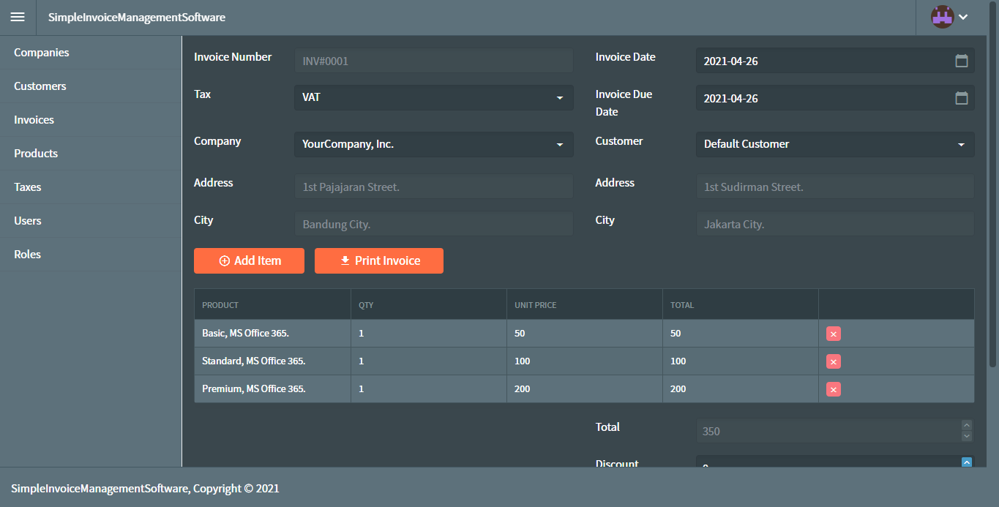
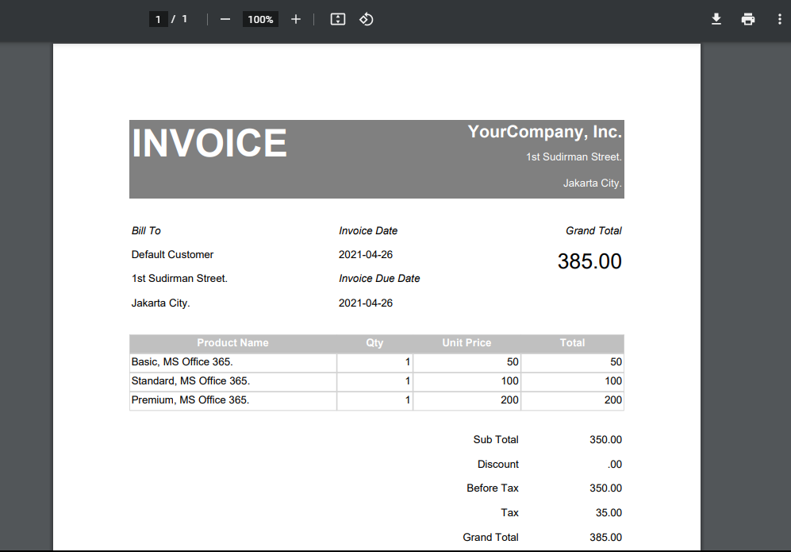

# Blazor Example Invoice Management Software
Blazor server real world example app. Fully functional invoice management software that can help you manage all your invoices and customers. Developed using Blazor framework and RDLC for invoice print out.

Live demo:
- URL: [http://blazor-invoice-simple.indotalent.com/Login](http://blazor-invoice-simple.indotalent.com/Login)
- Username: administrator
- Password: 123456

# Technical Features
- Visual Studio 2019 CE
- RadZen IDE Community [https://www.radzen.com/](https://www.radzen.com/)
- RadZen Blazor UI, Open Source MIT License [https://github.com/radzenhq/radzen-blazor](https://github.com/radzenhq/radzen-blazor)
- Blazor Server [https://docs.microsoft.com/en-us/aspnet/core/blazor/hosting-models?view=aspnetcore-5.0](https://docs.microsoft.com/en-us/aspnet/core/blazor/hosting-models?view=aspnetcore-5.0)
- EF
- RDLC 
- ASP.NET Core 5.0
- C#

# Functional Features
- Invoice Management
- Customer Management
- Company Management
- Product Management
- Tax Management
- Security and Memberships (Roles based access)

# Project Structure
This open source project contains four folder, three of them are C# projects, and one of them is special config file for radzen IDE. Below are the explanation:
- **Entity** folder: contains C# project class library in the form of .NET standard 2.0. As its name implied, this project contain entity class that latter on will converted into tables in database.
- **RDLC** folder: contains C# WinForm project that I used to create .RDLC report file for invoice print out. After finish design the .RDLC file on this project, then I manually copy paste the .RDCL file into Blazor project at wwwroot/reports folder
- **meta** folder: contains JSON file as a kind of config file, used by radzen to generate CRUD pages and its related services.
- **server** folder: contains Blazor server project targeting ASP.NET Core 5.0 that actually the main project of this open source solution.

# How to Run the Project
- Open the project using Visual Studio
- Change connection string to target your desired SQL server
- Run the project by press the "play" button at your Visual Studio IDE

**note:** The database will automatically created upon the first run of the project, so no need to create the database manually.

# Starred  
If you find this project useful, please consider supporting us by giving a star on GitHub! ⭐  
Your support keeps us motivated and helps us continue developing and improving this project to deliver even greater value to the community.  

# 🌱 Help Us Grow!  
Please help us grow by sharing it with your friends, family, and colleagues!  
Every share helps us reach more people, grow the community, and continue improving this open-source project. ❤️  
 

# One Last Kiss ❤️  

Thanks for stopping by and reading this far! This project is supported by **INDOTALENT**

🌐 Feel free to visit: [https://store.indotalent.com](https://store.indotalent.com)  

### ✅ **How does Mini CRM help SMBs manage operations, drive growth, and streamline payroll?**

